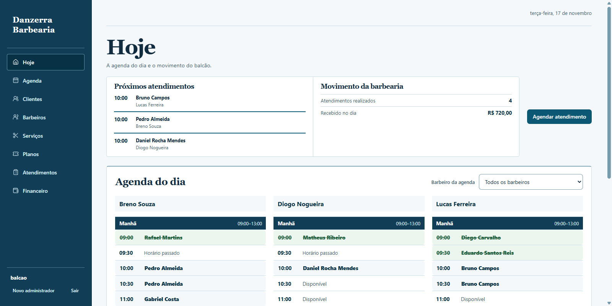
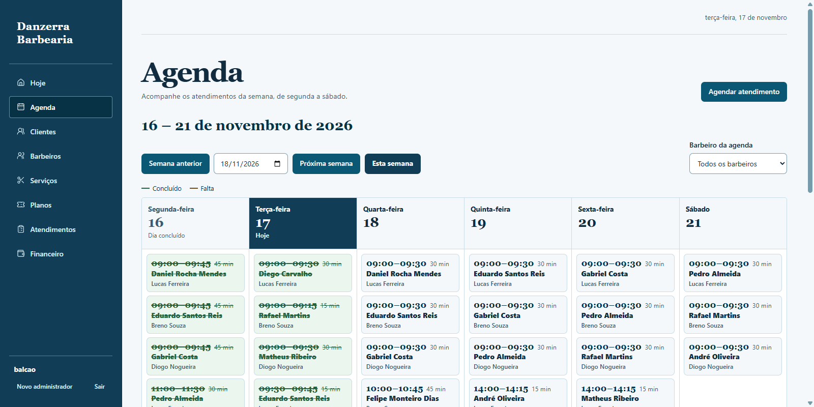
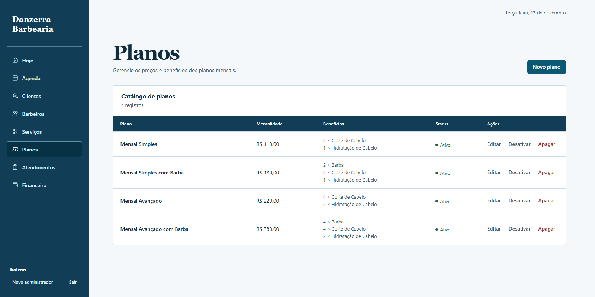

# Sistema de Gestão de barbearia

Sistema para organizar a rotina do balcão de uma barbearia: clientes, profissionais, serviços, planos mensais, agendamentos e movimento financeiro.

Projeto pessoal de estudo e portfólio, desenvolvido para praticar Java e Spring Boot, aprofundar conhecimentos de backend e entender o fluxo de uma aplicação integrada a um banco de dados e a uma interface web. O cenário de uso é o de um administrador que recebe os pedidos dos clientes e registra os atendimentos pelo painel.

## Demonstração

As capturas abaixo utilizam dados fictícios.

### Agenda do dia por barbeiro



### Planejamento semanal



### Planos mensais



## Funcionalidades

- **Administradores:** login, logout, consulta da conta autenticada e criação de outras contas administrativas.
- **Clientes:** cadastro, edição, exclusão quando não há vínculos, pesquisa, paginação e filtro por plano ativo.
- **Ficha do cliente:** vigência e saldo do plano, previsão de consumo dos benefícios e detalhes dos agendamentos.
- **Barbeiros:** cadastro, edição, ativação e desativação, perfil com agendamentos atuais e comparação de desempenho por período.
- **Serviços:** catálogo com preço avulso, duração, edição, ativação e desativação.
- **Planos mensais:** configuração de mensalidades e benefícios, contratação, renovação manual e preservação das condições contratadas.
- **Agenda:** planejamento semanal de segunda a sábado, horários disponíveis por profissional, remarcação e registro de conclusão, falta ou cancelamento.
- **Atendimentos:** acompanhamento por dia, semana ou mês e consulta dos serviços mais realizados.
- **Financeiro:** entradas de planos e serviços avulsos, registro de despesas e resultado de caixa por período.
- **Interface:** pesquisa durante a digitação, visualização de senhas e detalhes em janelas modais.

## Tecnologias

| Camada | Tecnologias |
| --- | --- |
| Backend | Java 21, Spring Boot 4.1.2, Spring MVC |
| Segurança | Spring Security, BCrypt, autenticação por sessão, CSRF |
| Persistência | PostgreSQL, Spring Data JPA / Hibernate, JdbcTemplate |
| Validação | Jakarta Bean Validation e validações nos services |
| Banco de dados | Migrations SQL com Flyway |
| Frontend | HTML, CSS e JavaScript com módulos ES |
| Build e testes | Maven Wrapper, JUnit e Spring Boot Test |

O frontend é servido pelo próprio Spring Boot. Não é necessário instalar Node.js ou executar um servidor de frontend separado para usar a aplicação.

## Organização do código

Os pacotes são organizados por domínio. Dentro de cada domínio, as responsabilidades são separadas conforme a necessidade.

```text
src/main/
├── java/projeto/barbearia/danzerra/
│   ├── administrador/   # Contas, autenticação e bootstrap inicial
│   ├── agenda/          # Agendamentos, disponibilidade e conclusão
│   ├── barbearia/       # Configurações da barbearia
│   ├── barbeiro/        # Profissionais, perfis e desempenho
│   ├── cliente/         # Cadastro e consulta de clientes
│   ├── config/          # Configuração do Spring Security
│   ├── plano/           # Catálogo e benefícios dos planos
│   ├── planocliente/    # Períodos contratados e saldo de benefícios
│   └── relatorio/       # Atendimentos, entradas e despesas
└── resources/
    ├── db/migration/    # Evolução do esquema com Flyway
    ├── static/          # Interface web
    └── application.properties
```

Fluxo usual de uma operação:

```text
Requisição HTTP → filtros de segurança → Controller → Service → Repository → PostgreSQL
```

O Spring converte o corpo da requisição em um DTO de entrada. Os controllers recebem os dados, os services aplicam as regras e os repositories acessam o banco. Mappers convertem os dados entre entidades e DTOs de resposta. A autenticação de login é processada pelos filtros do Spring Security com apoio do `AdministradorService`.

## Regras de negócio

### Agenda

- Segunda a sexta, das **09h às 13h** e das **14h às 18h**. Sábado, das **09h às 13h**. Domingo fechado.
- Datas e horários da operação seguem o fuso `America/Fortaleza`.
- Os horários de início são oferecidos de **30 em 30 minutos**. A duração resulta da soma dos serviços selecionados e precisa caber no expediente.
- A disponibilidade considera o barbeiro e o cliente. Barbeiros diferentes podem atender simultaneamente, mas o mesmo cliente não pode ocupar dois atendimentos sobrepostos.
- O cliente pode agendar cortes em datas diferentes; há uma restrição para outro corte agendado na mesma data.
- Conclusão e falta são registradas manualmente, a partir do início do atendimento. O horário passar não conclui o atendimento automaticamente.
- Somente atendimentos com status `AGENDADO` podem ser remarcados ou mudar de situação. Reversão de conclusão não está implementada.

### Planos

- O período começa na contratação e vence um mês depois. O benefício pode ser utilizado **até o dia do vencimento, inclusive**.
- Benefícios não utilizados expiram. A renovação é manual e só pode ocorrer depois do vencimento do período atual.
- Nome, preço e quantidades são registrados no momento da contratação. Alterações posteriores no catálogo não mudam as condições daquele período.
- O consumo ocorre **ao concluir o atendimento**. Cancelamento e falta não descontam benefícios.
- A previsão no detalhe do agendamento considera outros agendamentos pendentes do período para evitar prometer o mesmo saldo a todos. O consumo efetivo é confirmado na conclusão.
- Serviços sem cobertura disponível são cobrados como avulsos.
- Planos com serviços inativos não podem receber novas contratações. Desativar um serviço desativa os planos afetados no catálogo.
- Remover um plano do catálogo preserva o período já contratado pelo cliente.

Os modelos iniciais de planos são cadastrados pelas migrations. É necessário definir os preços, vincular os serviços e ativá-los antes de contratar.

### Financeiro

A contratação de um plano registra a mensalidade como entrada na data da contratação. Ao concluir um atendimento, somente os valores avulsos entram no caixa; os serviços cobertos pelo plano não são contabilizados novamente.

O resultado exibido é **entradas menos despesas registradas**. Não há integração com meios de pagamento, controle de recebimento posterior ou cálculo contábil de lucro.

## Segurança implementada

- Autenticação com Spring Security e sessão do servidor.
- Rotas de negócio protegidas pela role `ADMIN`, incluindo o cadastro de outras contas.
- Senhas armazenadas como hash BCrypt com custo 12. Cadastro exige pelo menos 15 caracteres e no máximo 72 bytes em UTF-8.
- Proteção CSRF mantida ativa, inclusive no login e no logout.
- O frontend envia o cookie de sessão em chamadas à mesma origem e mantém o token CSRF em memória. O token é limpo após login e logout para ser obtido novamente quando necessário.
- Resposta de login inválido sem distinguir usuário inexistente de senha incorreta.
- Validação de entrada no backend, DTOs de resposta e consultas parametrizadas.
- Uso de `textContent` para exibir textos dos registros na interface.
- Credenciais locais lidas do `.env`, que está ignorado pelo Git.
- Primeiro administrador criado por bootstrap opcional, somente quando não existe nenhuma conta.

Todos os administradores têm as mesmas permissões. O cadastro de um barbeiro não cria uma conta de acesso para ele.

## Como executar localmente

### 1. Pré-requisitos

- JDK 21 ou superior compatível com a versão do Spring Boot utilizada.
- PostgreSQL instalado e em execução. O desenvolvimento local utilizou PostgreSQL 18.
- Git. O pgAdmin pode ser utilizado para criar e consultar o banco.

O Maven Wrapper acompanha o projeto. Não é necessário Docker.

### 2. Clonar o repositório

```powershell
git clone https://github.com/jldantass/danzerra-barbearia.git
cd danzerra-barbearia
```

### 3. Criar usuário e banco pelo pgAdmin

Conecte ao PostgreSQL com uma conta que tenha permissão para criar roles e bancos. Abra o **Query Tool** no banco `postgres`.

Execute cada comando abaixo separadamente, substituindo a senha de exemplo por uma senha local escolhida por você:

```sql
CREATE ROLE barbearia LOGIN PASSWORD 'SUBSTITUA_PELA_SENHA_DO_BANCO';
```

```sql
CREATE DATABASE barbearia OWNER barbearia;
```

Se já houver um usuário e banco configurados com esses nomes, utilize os existentes.

A configuração padrão usa `127.0.0.1:5432/barbearia` e o usuário `barbearia`. Para outra configuração, ajuste `spring.datasource.url` e `spring.datasource.username` ou utilize as variáveis `SPRING_DATASOURCE_URL` e `SPRING_DATASOURCE_USERNAME`.

### 4. Configurar o ambiente e o primeiro administrador

Na raiz do projeto:

```powershell
Copy-Item .env.example .env
```

Edite o `.env` com a senha do banco e as credenciais que você escolher para o primeiro administrador. Para a primeira execução, configure:

```properties
DB_PASSWORD=SUA_SENHA_LOCAL_DO_BANCO
danzerra.admin.inicial.habilitado=true
danzerra.admin.inicial.login=SEU_LOGIN_ADMIN
danzerra.admin.inicial.senha=SUA_SENHA_ADMIN_COM_15_OU_MAIS_CARACTERES
```

Os valores acima são marcadores, não credenciais prontas para uso. O login deve ter entre 3 e 50 caracteres, usando letras sem acento, números, ponto, hífen ou sublinhado. A senha deve respeitar os limites descritos na seção de segurança.

O `.env` é importado pelo Spring como um arquivo `.properties`, por meio de `spring.config.import`. Mantenha-o na raiz e inicie a aplicação a partir dessa pasta.

### 5. Iniciar a aplicação

No PowerShell:

```powershell
.\mvnw.cmd spring-boot:run
```

No Linux ou macOS:

```bash
sh mvnw spring-boot:run
```

Também é possível executar `DanzerraApplication` pelo IntelliJ, com o diretório de trabalho apontando para a raiz do projeto.

Abra **[http://localhost:8080](http://localhost:8080)** e entre com o administrador configurado. O Flyway executa as migrations automaticamente; o Hibernate valida o esquema com `ddl-auto=validate`.

Depois de criar a primeira conta, defina `danzerra.admin.inicial.habilitado=false` e remova as propriedades de login e senha inicial do `.env`. Mantenha `DB_PASSWORD` para a conexão com o banco.

### 6. Preparar o catálogo

1. Edite o cadastro inicial **Barbeiro principal** e adicione outros profissionais, se desejar.
2. Cadastre os serviços com preço avulso e duração.
3. Edite os modelos de planos, vincule os serviços, defina as mensalidades e ative-os.
4. Cadastre clientes, contrate planos quando necessário e comece os agendamentos.

## Uso da API

Todas as rotas abaixo têm como base `http://localhost:8080`. O projeto mantém os nomes de rotas adotados durante o aprendizado.

| Recurso | Rotas principais |
| --- | --- |
| Autenticação | `GET /api/auth/csrf`, `POST /api/auth/login`, `GET /api/auth/me`, `POST /api/auth/logout` |
| Administradores | `POST /api/cadastrar_administrador` |
| Clientes | `GET /api/clientes`, `GET /api/clientes/{id}`, `POST /api/cadastrar_cliente`, `PUT /api/atualizar_cliente/{id}`, `DELETE /api/apagar_cliente/{id}` |
| Barbeiros | `GET /api/barbeiros`, `GET /api/barbeiros/{id}`, `POST /api/cadastrar_barbeiro`, `PUT /api/atualizar_barbeiro/{id}`, `PUT /api/onoff_barbeiro/{id}`, `DELETE /api/apagar_barbeiro/{id}` |
| Serviços | `GET /api/servicos`, `POST /api/cadastrar_servico`, `PUT /api/atualizar_servico/{id}`, `PUT /api/onoff_servico/{id}`, `DELETE /api/apagar_servico/{id}` |
| Planos | `GET /api/planos`, `GET /api/planos/{id}`, `POST /api/cadastrar_plano`, `PUT /api/atualizar_plano/{id}`, `PUT /api/onoff_plano/{id}`, `DELETE /api/apagar_plano/{id}` |
| Plano do cliente | `GET /api/planos_cliente/{clienteId}`, `POST /api/cadastrar_plano_cliente` |
| Agenda | `GET /api/agendamentos`, `GET /api/agendamentos/{id}`, `POST /api/cadastrar_agendamento`, `PUT /api/atualizar_agendamento/{id}`, `PUT /api/status_agendamento/{id}` |
| Disponibilidade e perfis | `GET /api/horarios_agenda`, `GET /api/planejamento_agenda`, `GET /api/agendamentos_cliente/{clienteId}`, `GET /api/agendamentos_barbeiro/{barbeiroId}` |
| Relatórios | `GET /api/relatorios`, `GET /api/barbeiros/desempenho`, `POST /api/cadastrar_despesa` |
| Barbearia | `GET /api/barbearia`, `PUT /api/atualizar_barbearia` |

### Autenticação pelo Insomnia

1. Faça `GET /api/auth/csrf` e mantenha os cookies recebidos.
2. Envie `POST /api/auth/login` com corpo **Form URL Encoded**, usando os campos `login` e `senha`. Inclua o cabeçalho cujo nome e valor vieram em `headerName` e `token` na etapa anterior.
3. Após o login, busque novamente `GET /api/auth/csrf`, usando o mesmo armazenamento de cookies.
4. Nas alterações seguintes, envie o token no cabeçalho retornado, mantendo o cookie da sessão autenticada.

Não é necessário obter um token a cada cadastro. Ele pode ser reutilizado na sessão até ser invalidado. O token CSRF, sozinho, não autentica o usuário.

Exemplo de cadastro de cliente com corpo JSON, após autenticar:

```http
POST /api/cadastrar_cliente
Content-Type: application/json
X-CSRF-TOKEN: TOKEN_OBTIDO_NA_SESSAO
```

```json
{
  "nome": "Cliente de demonstração",
  "celular": "83900000000"
}
```

## Verificação e testes

O teste automatizado versionado atualmente é um teste de carregamento do contexto Spring. Ele precisa de uma conexão PostgreSQL válida. Ainda não há uma suíte automatizada abrangente das regras de negócio e dos controles de segurança.

Para rodar o teste em um banco separado, crie `barbearia_test` com o proprietário `barbearia` pelo pgAdmin e, em um terminal exclusivo para testes, execute:

```powershell
$env:SPRING_DATASOURCE_URL = 'jdbc:postgresql://127.0.0.1:5432/barbearia_test'
$env:DANZERRA_ADMIN_INICIAL_HABILITADO = 'false'
.\mvnw.cmd test
```

O usuário e a senha continuam vindo da configuração local. Ao terminar, feche esse terminal para não reutilizar a URL do banco de testes ao iniciar o painel.

Para gerar o JAR após configurar o banco de testes:

```powershell
.\mvnw.cmd package
```

## Autor

**João Lucas Dantas** — estudante de Ciência da Computação.

[LinkedIn](https://www.linkedin.com/in/jldantas/) · [GitHub](https://github.com/jldantass)
